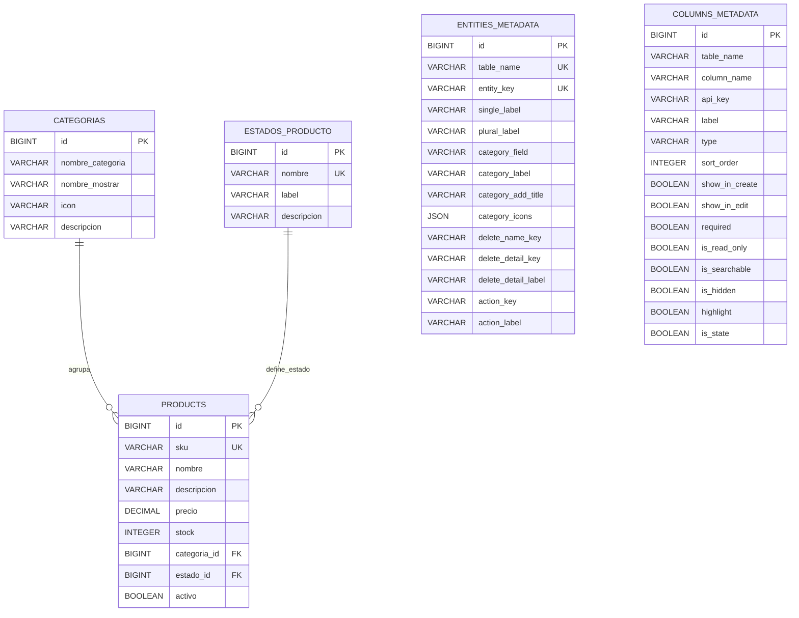

# Product Microservice (product-api v1)

## Descripción

Microservicio encargado de administrar el catálogo de productos del sistema.

Permite crear, consultar, actualizar y desactivar productos, administrar
categorías y entregar metadata para el mantenedor del frontend.

---

## Tech Stack

- Java 25
- Spring Boot 4.0.6
- Spring Security
- JWT
- Spring Data JPA
- MySQL
- Flyway
- Docker
- Maven
- Eureka Client

---

## Funcionalidades

- Crear, listar, actualizar y desactivar productos
- Buscar productos por ID o por categoría
- Listar productos activos
- Administrar categorías
- Entregar metadata de columnas, estados y formularios
- Mantener estados y categorías como entidades relacionadas

---

## Modelo de Datos



---

## API / Endpoints

Base URL:

```txt
/api/v1/products
```

| Acción               | Método | Endpoint                                |
| -------------------- | ------ | --------------------------------------- |
| Crear producto       | POST   | `/api/v1/products`                      |
| Listar productos     | GET    | `/api/v1/products`                      |
| Listar activos       | GET    | `/api/v1/products/active`               |
| Buscar por ID        | GET    | `/api/v1/products/{id}`                 |
| Buscar por categoría | GET    | `/api/v1/products/category/{categoria}` |
| Actualizar producto  | PUT    | `/api/v1/products/{id}`                 |
| Desactivar producto  | DELETE | `/api/v1/products/{id}`                 |
| Obtener metadata     | GET    | `/api/v1/products/metadata`             |
| Listar categorías    | GET    | `/api/v1/products/categories`           |
| Crear categoría      | POST   | `/api/v1/products/categories`           |
| Actualizar categoría | PUT    | `/api/v1/products/categories/{id}`      |
| Eliminar categoría   | DELETE | `/api/v1/products/categories/{id}`      |

`/category/{categoria}` recibe el valor interno `nombre_categoria`, por ejemplo
`Alimentos para perros`.

---

## Ejemplo de Request

```http
POST http://localhost:8005/api/v1/products
```

Body:

```json
{
  "nombre": "Collar para perro",
  "sku": "AC-703",
  "descripcion": "Collar ajustable color rojo",
  "precio": 5990,
  "stock": 20,
  "categoria": 5,
  "estado": "activo"
}
```

`categoria` corresponde al ID de la categoría y `estado` a la clave del estado
(`activo`, `inactivo`, `preparando`). `descripcion`, `sku` y `estado` son
obligatorios.

---

## Ejemplo de Response

```json
{
  "id": 1,
  "nombre": "Collar para perro",
  "sku": "AC-703",
  "descripcion": "Collar ajustable color rojo",
  "precio": 5990,
  "stock": 20,
  "categoria": "Accesorios",
  "id_categoria": 5,
  "estado": "Activo",
  "id_estado": 1,
  "activo": true
}
```

---

## Ejemplo de categoría

```json
{
  "nombreCategoria": "Accesorios",
  "nombreMostrar": "Accesorios",
  "icon": "🎒",
  "descripcion": "Accesorios para mascotas."
}
```

La descripción de la categoría es obligatoria.

---

## Variables de entorno

```env
SPRING_ENV=dev
SPRING_APP_NAME=ProductMicroservice
SPRING_LOG_LEVEL=WARN

SPRING_JWT_SECRET=secret-key
SPRING_JWT_PUBLIC=/**,/v3/api-docs/**,/swagger-ui/**
SPRING_JWT_ISSUER=login-service
SPRING_EUREKA_URL=http://localhost:8123/eureka

HOST_PORT=8005
HOST_DB_PORT=3205

MYSQL_DATABASE=product
MYSQL_HOST=localhost
MYSQL_PASSWORD=password
MYSQL_ROOT_PASSWORD=root_password
MYSQL_USER=user

PHPMYADMIN_PORT=8105
DOCKER_DOMAIN_NETWORK=fullstack_network
```

---

## Ejecución

```bash
docker compose up -d
./mvnw spring-boot:run
```

---

## Tests

```bash
./mvnw test
```

---

## Seguridad

Los endpoints protegidos utilizan JWT.

Header:

```txt
Authorization: Bearer TOKEN
```

## Eureka y API Gateway

El servicio se registra en Eureka con el nombre estable:

```txt
PRODUCT-SERVICE
```

`store-manager` puede consumirlo internamente mediante ese nombre lógico. Como
`product` es un servicio interno orquestado por el manager, no necesita una ruta
pública propia en el API Gateway. El Gateway debe exponer la ruta del manager.

---

## Equipo

- Eduardo Bray
- Rodrigo Callealta
- Fernando Villalobos

> DuocUC — FullStack 1 © 2026
